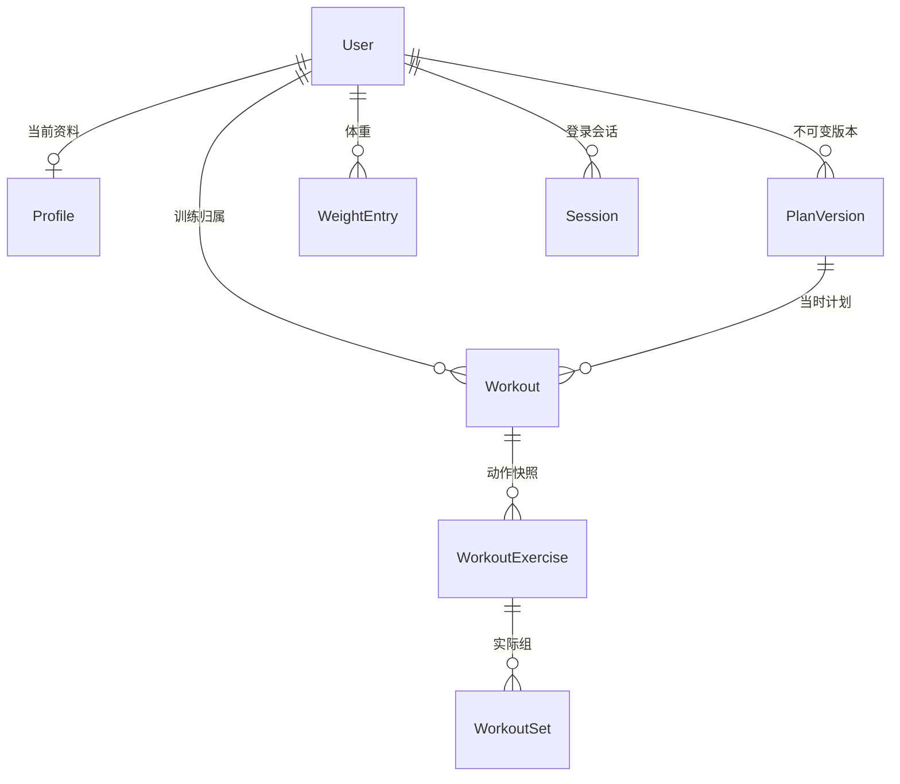

# 后端数据模型与接口设计

步骤 1、2 建立 TypeScript + Fastify + Prisma + PostgreSQL 的本地基础。第 3 步现已增加注册、登录、数据库会话、个人数据读取及资料保存，见 BACKEND-ACCOUNTS.md。第 4 步页面读写已接入，见 BACKEND-INTEGRATION.md；浏览器数据迁移仍为第 5 步，不会自动上传个人资料。

## 数据职责



`Exercise` 是独立公共目录。训练动作保留 `exerciseId`，但不设目录外键：旧版未知动作必须原样保留，不能因目录调整丢失记录。查询上次成绩时仍使用“同账户 + 稳定动作编号 + 单位”。

| 表              | 关键字段与含义                                                                                |
| --------------- | --------------------------------------------------------------------------------------------- |
| User            | UUID 账户编号、邮箱、加盐密码哈希；旧虚构账户缺少密码不能登录                                 |
| Session         | 会话哈希、账户归属、绝对过期时间、单调创建序号；数据库不保存原令牌                            |
| Profile         | userId、data JSON、revision；data 保留当前原型资料字段和缺省语义                              |
| Exercise        | 原稳定编号、中文/英文名、部位、设备、目标肌群、双语步骤、单位、来源与来源提交号；没有媒体字段 |
| PlanVersion     | userId + version 唯一；snapshot JSON 包含完整资料、计划来源、逐动作目标、替换清单等版本信息   |
| Workout         | userId + 原训练 id；planVersion、planName、date、起止时间、status、notes、origin、revision    |
| WorkoutExercise | 当前训练内独立 id、目录 exerciseId、当时名称和单位、position、prescription JSON               |
| WorkoutSet      | 原组 id、position、loadKg、value、rir、pain                                                   |
| WeightEntry     | userId + 稳定 id、date、kg；不按同日/同重量去重                                               |

计划文档使用 JSON 快照，是为了保留现有备份结构与逐动作目标，而不是把整份浏览器状态塞进一张表。可查询的训练、动作、组和体重采用独立关联表。个人资料与 JSON 快照还需要后续接口调用现有业务校验器，数据库不会自行理解 JSON 内所有字段。

## 单位、时间和一致性

- `loadKg`、`kg` 为十进制千克，数据库保留三位小数；未来导入不得静默四舍五入，超精度数据必须预览提示或先调整模型。
- `value` 为整数，由动作的 reps / seconds 决定；unspecified 只允许存在于公开目录。
- `date` 用 PostgreSQL DATE 保存用户本地日历日期；起止时间用带时区时间戳保存 UTC 时刻，不从时区转换推算旧版缺失时间。
- 复合外键将账户归属带入计划、训练、动作和组；无法把训练绑定到另一账户的计划。这不是身份认证，API 仍须检查登录账户。
- 每个账户最多一个 active 训练，由部分唯一索引保证。
- PlanVersion 的 UPDATE 被数据库触发器拒绝；修改必须新增版本。开始训练时复制名称、单位及目标，后续新版本不能修改旧训练。
- 训练动作的 exerciseId 和 unit 不可更新，防止重新解释历史成绩。
- 负重 0–400 kg；次数 1–100、秒数 1–3600；RIR 可空或 0–3。这是沿用原型录入边界，不代表推荐训练强度。
- Profile 的 expectedRevision 冲突检查已在第 3 步资料保存接口实现；Workout revision 已用于第 4 步训练修改/删除；页面已接入，离线队列与幂等重试仍为第 6 步。

## 已实现接口

基础地址为 `http://127.0.0.1:3100/api/v1`，下表为公开只读目录和服务状态。新增账户及个人接口见 BACKEND-ACCOUNTS.md。尚未启用跨域访问，后续前端接入优先采用同源代理。

| 路径              | 输入                                           | 输出                                 |
| ----------------- | ---------------------------------------------- | ------------------------------------ |
| /health           | 无                                             | 进程健康；数据库断开仍可返回 200     |
| /ready            | 无                                             | 实际查询数据库，成功 200，不可用 503 |
| /exercises        | q、bodyPart、equipment、origin、page、pageSize | items 摘要 + pagination              |
| /exercises/:id    | URI 编码后的稳定 ID                            | item 完整文字详情和来源              |
| /exercise-filters | 无                                             | 目录中的部位、设备、来源筛选选项     |

分页默认 24 条，最多 100 条；page 从 1 开始，最多 100000。q 最多 100 字符，支持中文、英文、编号、目标肌群搜索；部位/设备按目录原始标签精确匹配，origin 为 builtin / community。搜索结果按稳定 ID 排序，总数与分页在同一事务快照内读取。

```json
{
  "items": [{ "id": "lianxu:plank", "nameZh": "平板支撑", "unit": "seconds" }],
  "pagination": { "page": 1, "pageSize": 24, "total": 1, "totalPages": 1 }
}
```

示例省略了摘要中的英文名、部位、设备、目标和来源字段。详情保留 sourceId / sourceCommit / stepsZh / stepsEn 等。无效参数返回 400；不存在的动作 404；数据库不可用 503。统一错误结构为 `{"error":{"code":"...","message":"..."}}`，不返回 SQL、连接字符串或堆栈。

## 接口推进顺序

| 阶段     | 接口方向                                          | 约定                                                                      |
| -------- | ------------------------------------------------- | ------------------------------------------------------------------------- |
| 3 账户   | /auth/*、/me                                      | 已实现并接入页面，详见 BACKEND-ACCOUNTS.md / BACKEND-INTEGRATION.md       |
| 4 接入   | /me/profile、/me/plans、/me/workouts、/me/weights | 分模块读写；写入带 expectedRevision，冲突 409；计划确认带 expectedVersion |
| 5 迁移   | /me/imports/preview、/me/imports/:id/confirm      | 已实现；校验旧备份，保留稳定 ID，事务写入；见 BACKEND-IMPORTS.md          |
| 6 可靠性 | 写入请求幂等编号、待同步队列                      | 已实现：成功回执与业务同事务、浏览器单项待同步；见 BACKEND-RELIABILITY.md |
| 7 AI     | /me/plan-drafts                                   | 后端生成草稿，校验目录 ID/单位/设备，用户确认后才建版本                   |
| 8 照片   | 私有文件上传、分析任务、删除                      | 对象存储保存文件，数据库保存归属/状态/保留期；不保存图片到仓库            |

## 迁移设计边界

第 5 步不扫描 localStorage，也不自动导入真实记录。采用原有 v2 JSON 备份作为输入：保留原始备份 → 后端验证和预览 → 用户确认 → 单一事务写入并核对条数、稳定 ID、数值、单位和版本。已有账户保留当前资料和计划，空账户采用备份资料；冲突拒绝整批导入。旧记录缺失的起止时间继续 null。字段重命名 load → loadKg 需显式映射；照片不在备份中。

后端固定监听 127.0.0.1，仅本机使用。第 3 步已验证两个虚构账户的后端数据隔离；第 4 步已实现前端账户切换及个人写入；第六步已有单项待同步与安全重试；真实 AI、照片、饮食计算和完整离线训练仍属于后续步骤。
